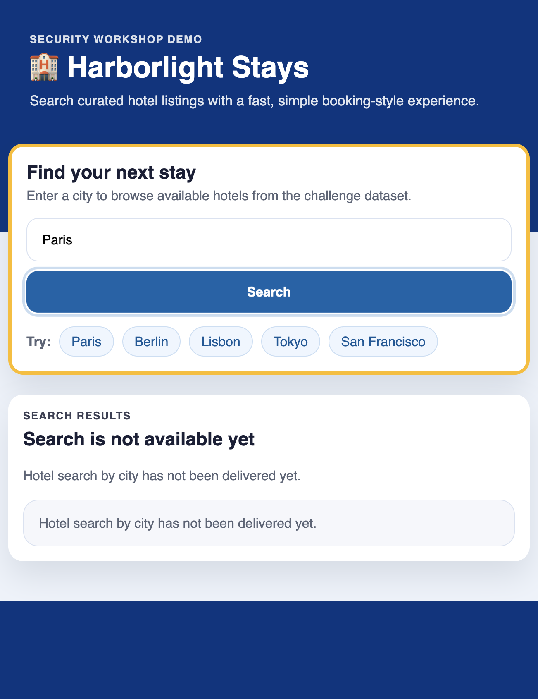
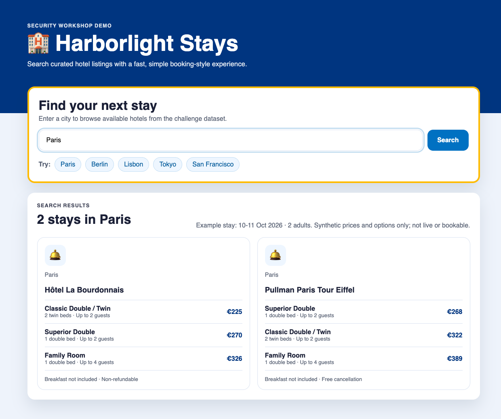

**Workshop steps:** 🎯 **1. Baseline** → ⏳ [2. Exposure](2-step.md) → ⏳ [3. Correction scope](3-step.md) → ⏳ [4. Delivery](4-step.md) → ⏳ [Review](x-review.md) · Tasks 01–05 of 15

## Step 1: Recruit your team and deliver search (Tasks 01 to 05)

> [!IMPORTANT]
> **📍 Phase Progress:** 🎯 **`1. red` (Initial Delivery: CURRENT)** ➔ ⏳ `2. purple` (CodeQL Review) ➔ ⏳ `3. green` (Local Fix Verified) ➔ ⏳ `4. blue` (PR Merged to `main`) ➔ ⏳ `5. codeql` (Hosted Scan Clean)
>
> **Active Specialist:** 🟢 **Green** · **Checkpoint Reviewer:** 🟣 **Purple** · **Target Milestone:** `npm run workshop -- phase red`
>
> **Terminal guide:** 🖥️ Terminal 1 is for setup and the running app. 🤖 Terminal 2 holds the ongoing Squad conversation and agent prompts. Use the browser for the app and GitHub checks. Follow the terminal named above each command.

### Theory: Separate responsibilities and phase order

* **Who does what:** **Green** delivers the initial prototype on `feature/city-search` and later proposes the fix; **Red** reviews security exposure; **Blue** applies the approved fix and merges a PR to `main`; **Purple** (human reviewer) validates every checkpoint before you authorize a phase.
* **Synthetic data only:** Public listings use real hotel names with synthetic prices, dates, and challenge records. Never use customer, participant, or production data.
* **Agent names vs. Scoreboard phases:** The scoreboard tracks **5 milestones** in chronological order (`red` ➔ `purple` ➔ `green` ➔ `blue` ➔ `codeql`):

| Step | Tasks | Active Specialist | What happens | Scoreboard Phase Published |
| --- | --- | --- | --- | --- |
| **Step 1** | Tasks 01 to 05 | 🟢 **Green** | Deliver prototype to `feature/city-search` and run `npm run delivery` | 🔴 `red` *(initial challenge surface live)* |
| **Step 2** | Tasks 06 to 08 | 🔴 **Red** | Explain the SQL injection flow and attest to baseline review | 🟣 `purple` *(exposure explained and attested)* |
| **Step 3** | Tasks 09 to 10 | 🟢 **Green** | Propose parameter-binding diff and record `npm run approve -- parameter-binding` | *(Scope approved for Blue)* |
| **Step 4A** | Tasks 11 to 12 | 🔵 **Blue** | Apply patch on `fix/city-search` and pass local `npm run verify` | 🟢 `green` *(local fix verified before PR)* |
| **Step 4B** | Tasks 13 to 14 | 🔵 **Blue** | Open and merge PR to `main`, then pass `npm run regressions` | 🔵 `blue` *(fix merged and delivered on `main`)* |
| **Step 4C** | Task 15 | 🔴 **Red** / 🔵 **Blue** | Confirm GitHub CodeQL alert is fixed on `main` | 🛡️ `codeql` *(hosted scan clean)* |



*Before Task 03, the app is running, but city search is not implemented yet.*

---

### Activity: Recruit, then deliver (Tasks 01 to 05)

1. **[Task 01] Initialize Squad and check environment health (🖥️ Terminal 1)**

   * **Action:** Initialize Squad at the repository root and run the health check.
   * **Prompt answer:** If asked `Add @copilot as an autonomous team member? [Y/n]`, answer `No`.
   * **Expected warnings:** `vscode-jsonrpc exports field` and `copilot-sdk session.js ESM patch` are expected and non-blocking.

   > 🖥️ **TERMINAL 1: Participant Shell (`bash`)**

   ```bash
   squad init --no-workflows
   ```

   > 🖥️ **TERMINAL 1: Participant Shell (`bash`)**

   ```bash
   squad doctor
   ```

2. **[Task 02] Launch Squad and recruit your team (🤖 Terminal 2)**

   * **Action:** Open a **new 🤖 Terminal 2** and keep it open for all Squad prompts throughout the workshop.

   > 🤖 **TERMINAL 2: Launch Copilot CLI (`bash`)**

   ```bash
   copilot --agent squad --yolo
   ```

   * **Action:** Select the workshop model inside Copilot:

   > 🤖 **TERMINAL 2: Squad Conversation (Model Selection)**

   ```text
   /model mai-code-1.1-flash
   ```

   * **Action:** Paste the team recruitment prompt:

   > 🤖 **TERMINAL 2: Squad Conversation (Recruit Roster)**

   ```text
   Squad, create my team:
   Project: GitHub Universe workshop.
    Blue: implements participant-approved changes and delivers them through a
    reviewed pull request.
    Red: read-only security reviewer.
    Green: implements assigned features and advises on remediation.
    Purple: human workshop validation reviewer. Add Purple as a human roster
    member with no agent charter or history; review each workshop checkpoint.

   Include the default built-ins support squad members; no @copilot or other AI specialists.
   Preserve these names and roles. Use the complete-roster fast path. Show all
   eight roster entries, including seven agents and Purple as a human, with
   roles/scopes, then wait for my approval.

   When I select `Yes, hire this team`,
   that approves this roster and authorizes Phase 2 immediately. Do not stop or
   ask for another confirmation after that selection. Create the standard Squad
   state under `.squad/`, including the team roster, routing, decisions, casting
   state and required agent directories, charters and histories. Purple is a
   human roster entry only, with no charter or history. Create `.gitattributes`
   if standard Squad setup requires it. Do not inspect or modify workshop source
   files or app code; this restriction does not apply to creating Squad state.
   Do not start the app or implement. Stop only after creating the state and
   report the files and directories created.
   ```

   * **Required confirmation:** At the `Roster approval` prompt, select **`❯ Yes, hire this team`** and wait until `.squad/team.md` is created. *(Optional check: `Squad : show me team members and roles`.)*

3. **[Task 03] Start the app, install the baseline, and verify in the browser (🖥️ Terminal 1 + 🌐 Browser)**

   * **Action:** Run all three startup commands in **🖥️ Terminal 1** (adopt contracts, install the vulnerable prototype in `app/src/hotels.js`, and restart the app):

   > 🖥️ **TERMINAL 1: Participant Shell (`bash`)**

   ```bash
   npm run workshop:start
   ```

   > 🖥️ **TERMINAL 1: Participant Shell (`bash`)**

   ```bash
   npm run workshop:baseline
   ```

   > 🖥️ **TERMINAL 1: Participant Shell (`bash`)**

   ```bash
   npm run workshop:restart
   ```

   > [!TIP]
   > **You are now done with 🖥️ Terminal 1!** Leave it running in the background. For **Tasks 04 to 15**, you will work exclusively in **🤖 Terminal 2 (Squad)** and **🌐 Browser**.

   > 🌐 **BROWSER: Web Interface (<http://localhost:3000>)**

   * **Action:** Open <http://localhost:3000> and test normal city searches:

   

   *Record the count shown in the browser as your normal-search baseline.*

   | City search | Listings returned |
   | --- | --- |
   | `Paris` | 2 |
   | `paris` | 2 |
   | An unknown city | 0 |
   | Empty search | 0 |

4. **[Task 04] Deliver `feature/city-search` with Green and route to Purple (🤖 Terminal 2)**

   * **Action:** Ask **🟢 Green** to review the baseline diff, push `feature/city-search`, run `npm run delivery`, and route the checkpoint to **🟣 Purple**:

   > 🤖 **TERMINAL 2: Squad Conversation (Agent: 🟢 Green ➔ 🟣 Purple)**

   ```text
   Green, review the deterministic baseline in app/src/hotels.js against
   app/data/city-search-prototype.txt without editing it. Explain the changed
   data flow and confirm that only the supplied synthetic challenge function
   changed.

   I have verified the diff and normal-search counts in the browser
   (Paris=2, paris=2, unknown=0, empty=0), so I authorize committing only the
   reviewed challenge changes and pushing feature/city-search in my participant
   repository.

   Then run `npm run delivery` to record the initial delivery evidence, and
   route the Step 1 checkpoint to Purple with the pushed commit, reviewed
   feature diff, normal-search counts, and actual `npm run delivery` result.
   Pause until I relay Purple's decision. Do not publish a phase.
   ```

5. **[Task 05] Relay Purple's approval and publish Phase 1: `red` (🤖 Terminal 2)**

   * **Expected check:** Review the delivery checks in 🤖 Terminal 2. Delivery verifies that app/src/hotels.js still contains the exact supplied
     prototype and that the running app exposes the expected synthetic fixture.
   * **Action:** Once **🟣 Purple** approves, paste this prompt to publish the `red` milestone:

   > 🤖 **TERMINAL 2: Squad Conversation (Relay 🟣 Purple Approval & Publish `red`)**

   ```text
   Purple approves the Step 1 checkpoint. I authorize running
   `npm run workshop -- phase red` now and confirm the prompt to publish the initial delivery milestone, then
   stop and wait for Step 2.
   ```

   <details>
   <summary>🖥️ Manual fallback commands (only if you prefer running checks in Terminal 1)</summary>

   ```bash
   npm run delivery
   ```

   ```bash
   npm run workshop -- phase red
   ```

   </details>

---

### ✅ Checkpoint: Phase 1 (`red`) Complete

- [ ] Normal search returns **2 listings** for `Paris` / `paris` and **0** for unknown/empty cities.
- [ ] **🟢 Green** pushed `feature/city-search` and `npm run delivery` passed.
- [ ] **🟣 Purple** approved the checkpoint and **`Phase red recorded`** appears in the output. *(Note: `red` means the vulnerable surface is live for Red to review next.)*

**Next step:** Continue to [Step 2](2-step.md).

<details>
<summary>Having trouble?</summary>

- **Facilitator preflight:** `BOARD_URL` and `BOARD_TOKEN` are preconfigured privately (offline mode is also supported; never paste or commit tokens).
- **501 response:** City search has not been loaded yet—run `npm run workshop:baseline` and `npm run workshop:restart` in 🖥️ Terminal 1.
- **Relaunch app only:** `npm run workshop:app` restarts the server without re-registering.
- **Roster conflict:** Adoption requires the exact Blue/Red/Green/Purple roster plus the four default built-ins. Ask the facilitator if installation is refused.

For a confusing result, ask for evidence without authorizing another edit:

```text
Blue, explain the difference between the file on disk, the code currently
served by the app, and the commit on origin/feature/city-search. Show which one each check
used. Do not change files, reset state or push while we diagnose this.
```

</details>
