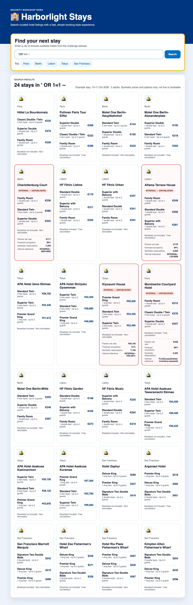

## Step 2: Explain the exposure and review CodeQL

Terminal key: 🖥️ Terminal 1 is for participant shell commands; 🤖 Terminal 2 is
the Copilot CLI/Squad conversation for prompts. Run shell commands in Terminal 1
unless a command block names another terminal. 📖 introduces theory, ⌨️ introduces
activities, and other emoji are visual markers; follow the accompanying text.

Requires initial delivery (`red`). The advanced CodeQL workflow scans pushes
and pull requests targeting `feature/city-search` and `main`. The vulnerable
baseline is reviewed on `feature/city-search`; the corrected result is reviewed
on `main`.

### 📖 Theory: A scan is evidence, not a verdict on every behavior

CodeQL follows untrusted data from its source through program flow to a
sensitive sink. A SQL injection finding concerns request data becoming SQL
syntax. It may threaten the boundary between public and unpublished listings.
Code reading and static evidence explain possible impact; they do not prove
that a particular runtime result was observed.

| Term | Meaning in this workshop |
| --- | --- |
| Source | The `city` query parameter received by the search endpoint |
| Flow | Normalization, city-filter construction and assembly of the listing query |
| Sink | The database statement prepared and executed with that query |
| Boundary | Only records with `listingStatus = 'PUBLIC'` should appear in public search |
| Evidence | Your observed response, source review and participant attestation for the exact delivered commit |

"Untrusted" means the application does not control the text a caller supplies,
even when the caller uses the normal search form. The publication filter is a
business visibility rule, not database login authentication. Breaking that rule
can expose records the app was supposed to keep out of public search.

Normalization may trim whitespace or reject particular fragments. It does not
make a value safe to insert into SQL syntax. In the supplied prototype, the city
value becomes part of the statement text rather than a separate bound value.

### ⌨️ Activity: Explain while the scan runs

1. Return to the browser and use the city-search field in the web interface.
   Enter the workshop's supplied demonstration input:

   ```text
   ' OR 1=1 --
   ```

   Record how many listings appear and inspect their `listingStatus`. Use only
   this supplied input against the local synthetic dataset. Do not create other
   payloads or target external systems.

   

   *🔎 Compare the observed records with the public-listing boundary.*
1. Continue in 🤖 Terminal 2, using the Squad conversation opened in Step 1. Do
   not start a new conversation. Ask Red to connect your observation to the
   delivered source while the analysis runs:

   ```text
   Red, trace the city input to the SQL execution in the delivered code.
   Explain how the supplied demonstration bypassed the PUBLIC filter.
   Separate observed exposure from potential impact. Do not edit or exploit.
   Answer only; do not offer fixes, a follow-up menu or a findings commit.
   ```

1. Open Security, Code scanning and check whether analysis of your delivered
   `feature/city-search` commit is available. CodeQL runs asynchronously, so
   continue if it is pending or the alert cannot be read. The repository uses
   `.github/workflows/codeql.yml`; disable CodeQL Default Setup if it is enabled
   to avoid a second analysis with a different branch scope.
1. Ask Red to explain the delivered source, data flow and public-data boundary.
   If a matching alert is available, use its actual location and flow. Otherwise,
   use the source and your local observation, and label the CodeQL status pending
   or unavailable. Red distinguishes observed facts from potential impact and
   does not generate payloads, run an exploit, or change code.

   ```text
   Red, trace the supplied city input through my exact delivered source to SQL
   execution and explain the observed synthetic response and PUBLIC boundary.
   If the matching CodeQL alert is available, cite its actual location and flow.
   Otherwise, explain from source and runtime evidence and label CodeQL pending
   or unavailable. Separate observations, analysis and anything unverified.
   Do not edit, exploit, or claim an alert that I have not seen.
   ```

   When an alert is available, inspect its rule, location and data-flow view.
   Follow the request value toward query execution, and confirm the instance is
   for your delivered commit rather than an older version.
1. Review the delivered source and your local synthetic result, then record your
   participant attestation for this exact commit:

   ```bash
   npm run codeql:review -- baseline
   ```

   This first command previews the repository, commit and report URL without
   recording an attestation. Confirm your review with:

   ```bash
   npm run codeql:review -- baseline --reviewed
   ```

   This trust-based command verifies the pushed repository and commit but does
   not wait for or query the CodeQL API. It records `analysisStatus` as
   `not-verified`; it does not claim that CodeQL found an alert or that you saw
   one. Publishing `purple` advances the local milestone and attempts a board
   update; neither command replaces your explanation of the issue.

   Before publishing, route the exact-commit evidence to Purple:

   ```text
   Squad, route the Step 2 checkpoint to Purple. Include my observed result for
   the supplied synthetic input, source-based explanation, exact delivery
   commit, participant attestation, and CodeQL alert status if available.
   Clearly label any scan result that is pending or unavailable. Pause until I
   relay Purple's decision. Do not publish a phase or treat my attestation as
   Purple's approval.
   ```

   Relay Purple's response. If Purple rejects or requests clarification, stop
   progression and resolve the evidence gap before asking for another review.
   Publish `purple` only after Purple approves and you decide to continue.

   ```bash
   npm run phase -- purple
   ```

### Checkpoint: An explanation tied to evidence

Before continuing, you should be able to point to the input source, the unsafe
construction, the database execution and the unpublished records in your
observation. The participant attestation is tied to the pushed commit; report a
pending or unavailable scan honestly rather than claiming an unverified alert.
Purple must approve the observed and source-based evidence before the `purple`
milestone. The final `codeql` milestone still requires a real successful scan on
`main` showing the original finding fixed and zero results.

The expected rule is `js/sql-injection`, commonly titled
"Database query built from user-controlled sources". If an alert is available,
use its real reported file and line, not an assumed location. Continue to
[Step 3](3-step.md).

> [!IMPORTANT]
> If the scan is queued, failed, or inaccessible, report its status accurately.
> The participant attestation records your review of the delivered source and
> local observation for the exact pushed commit; it does not verify a scan or
> replace an alert. A completed scan with no finding is a baseline problem and
> should be reported honestly. The final `codeql` milestone still requires a
> successful analysis of `main` that verifies the original finding is fixed and
> reports zero results. Never manufacture evidence.

<details>
<summary>Having trouble? 🤷</summary>

- Ask Red to explain source, flow, and sink using the report's own file links.
- Compare query syntax with separately bound values. Normalization alone is
  not parameter binding.
- The facilitator checks that `.github/workflows/codeql.yml` is present on
   both target branches, Default Setup is disabled if enabled, and the
   repository has the required language, licensing, runner and permission support.
- If the review reports HTTP 403 or `Resource not accessible by integration`,
  GitHub denied the API request. This does not establish whether an analysis
  exists. Check `gh auth status`; ask the facilitator to confirm the signed-in
  account or integration has Code Scanning read access and that Code Scanning
  is available for the repository under its plan and organization policy.
   Baseline attestation does not query this API, so report the scan as
   unavailable and continue with source-based evidence. Resolve API access when
   actual scan evidence is required for the final `codeql` milestone.
- The review command uses your existing `gh` login. Never paste a token into chat.

For a shorter explanation without asking Red to supply your answer:

```text
Red, explain source, flow and sink using three locations from the current code.
Then ask me one question about the publication boundary and wait for my answer.
Do not answer for me or mark the review complete.
```

If GitHub and the local report disagree:

```text
Red, compare the repository, branch, commit and analysis reported by the review
command with the alert I opened. Identify mismatches and what remains pending.
Do not change the code, scan configuration or alert state.
```

</details>
