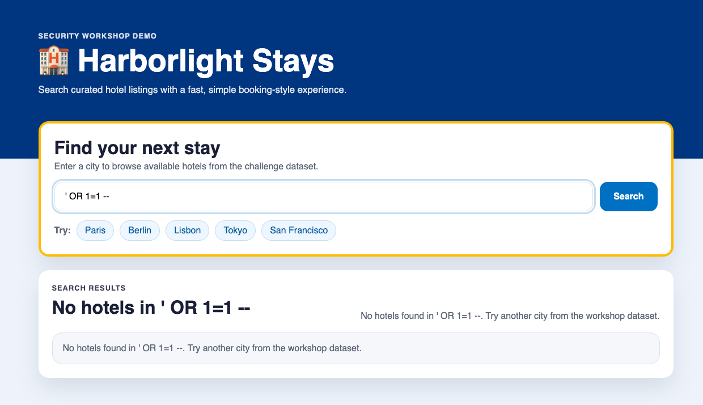

**Workshop steps:** ✅ [1. Baseline](1-step.md) → ✅ [2. Exposure](2-step.md) → ✅ [3. Correction scope](3-step.md) → 🎯 **4. Delivery** → ⏳ [Review](x-review.md) · Tasks 11–15 of 15

## Step 4: Deliver the correction and confirm fixed (Tasks 11 to 15)

### At a glance

* Current work: Verify the local fix, merge the PR, then confirm the hosted CodeQL alert is fixed.
* Roles: Blue delivers the approved fix; Purple reviews checkpoints; Red can compare scan results.
* Terminals: Continue in 🤖 Terminal 2 for Squad. Use 🖥️ Terminal 1 only for commands labeled there.
>
### Theory: Why `green` is validated before `blue` (and before `codeql`)

Step 4 advances through the final three scoreboard phases in strict order, matching the three environments where a fix must be proven:

| Sub-stage | Tasks | Scoreboard Phase | What is verified before publishing |
| --- | --- | --- | --- |
| **Stage 4A** | Tasks 11 to 12 | 🟢 **`green`** | **Local fix verified:** Blue applies Green's approved patch on `fix/city-search`, restarts the local app, and passes `npm run verify` |
| **Stage 4B** | Tasks 13 to 14 | 🔵 **`blue`** | **PR merged to `main`:** Blue opens and merges the PR to `main`, updates local `main`, and passes `npm run regressions` |
| **Stage 4C** | Task 15 | 🛡️ **`codeql`** | **Hosted scan clean:** GitHub CodeQL finishes scanning the merged commit on `main` and shows the original alert `fixed` |

---

### Stage 4A: Verify the fix locally and publish Phase 3: `green` (Tasks 11 to 12)

> **Phase target:** `3. green`, local fix verified

11. **[Task 11] Apply the patch on `fix/city-search`, verify locally, and route to Purple (🤖 Terminal 2 + 🌐 Browser)**

    * **Action:** Continue in 🤖 Terminal 2, using the Squad conversation opened in Step 1. Do not start a new conversation. Ask **🔵 Blue** to apply the patch on `fix/city-search`, restart the app, run `npm run verify`, and route to **🟣 Purple**:

    > 🤖 **TERMINAL 2: Squad Conversation (Agent: 🔵 Blue ➔ 🟣 Purple)**

    ```text
    Blue, create fix/city-search from feature/city-search and apply only Green's
    exact patch that I approved. Preserve normal search and the other filters.

    Restart the app with `npm run workshop:restart`, run `npm run verify` against
    the corrected code, and route the corrected-code checkpoint to Purple with
    your diff against feature/city-search, the restarted-app results, and actual
    `npm run verify` output. Pause until I relay Purple's decision. Do not
    publish a phase or push yet.
    ```

    > 🌐 **BROWSER: Web Interface (<http://localhost:3000>)**

    * **Action:** Test <http://localhost:3000> in the browser to confirm the injection now returns **0 listings**:

    | Check | Expected corrected behavior |
    | --- | --- |
    | `Paris`, then `paris` | The same 2 public listings |
    | `' OR 1=1 --` (demonstration input) | **0 listings** (treated as literal city text) |

    

    *✅ Confirm the corrected result after restarting the app.*

12. **[Task 12] Relay Purple's approval, publish Phase 3: `green`, and open the PR to `main` (🤖 Terminal 2)**

    * **Action:** Relay **🟣 Purple**'s approval to publish `green`, then have **🔵 Blue** push `fix/city-search`, open the PR to `main`, and route the PR checkpoint to **🟣 Purple**:

    > 🤖 **TERMINAL 2: Squad Conversation (Publish `green`, Open PR & Route to 🟣 Purple)**

    ```text
    Purple approves the corrected-code checkpoint. I authorize running
    `npm run workshop -- phase green` now and confirm the prompt to record local fix verification.

    Then I authorize Blue to commit only the reviewed correction and agreed tests on
    fix/city-search, push that branch, and open a PR targeting main. Do not merge
    yet. Then route the pull-request checkpoint to Purple with the PR URL, source
    commit, complete PR diff against main, and required check results. Pause
    until I relay Purple's decision.
    ```

---

### Stage 4B: Merge the PR to `main` and publish Phase 4: `blue` (Tasks 13 to 14)

> **Phase target:** `4. blue`, PR merged to `main`

13. **[Task 13] Relay Purple's PR approval, merge to `main`, and run regressions (🤖 Terminal 2)**

    * **Action:** Review the PR on GitHub, then relay **🟣 Purple**'s approval so **🔵 Blue** merges the PR, updates local `main`, runs `npm run regressions`, and routes the result to **🟣 Purple**:

    > 🤖 **TERMINAL 2: Squad Conversation (Merge PR, Run Regressions & Route to 🟣 Purple)**

    ```text
    Purple approves the pull-request checkpoint, and I reviewed the PR to main
    with passing checks. I explicitly authorize Blue to merge this PR, update
    local main (`git switch main` and `git pull --ff-only`), and run
    `npm run regressions`.

    Then route the merged-delivery checkpoint to Purple with the merge commit on
    origin/main and actual `npm run regressions` result. Pause until I relay
    Purple's decision. Do not publish a phase or claim CodeQL is clean from a
    merge.
    ```

14. **[Task 14] Relay Purple's approval and publish Phase 4: `blue` (🤖 Terminal 2)**

    * **Action:** Relay **🟣 Purple**'s approval to publish the `blue` delivery milestone:

    > 🤖 **TERMINAL 2: Squad Conversation (Relay 🟣 Purple Approval & Publish `blue`)**

    ```text
    Purple approves the merged-delivery checkpoint. I authorize running
    `npm run workshop -- phase blue` now and confirm the prompt to record delivery on main, then stop while we
    check the hosted CodeQL analysis.
    ```

---

### Stage 4C: Confirm hosted CodeQL scan and publish Phase 5: `codeql` (Task 15)

> **Phase target:** `5. codeql`, hosted scan clean

15. **[Task 15] Review the fixed CodeQL alert on `main` and publish Phase 5: `codeql` (🌐 Browser + 🤖 Terminal 2)**

    > 🌐 **BROWSER: GitHub Repository (`Security > Code scanning`)**

    * **Action:** Check **Security > Code scanning** on GitHub until the analysis on `main` completes and shows the original alert **fixed**.

    > 🤖 **TERMINAL 2: Squad Conversation (Inspect `fixed` Report & Route to 🟣 Purple)**

    ```text
    Squad, run `npm run codeql:review -- fixed` and have Red compare the initial
    finding with the final CodeQL report on my corrected main SHA.

    If analysis is complete and the same alert shows fixed with zero results,
    route the final CodeQL checkpoint to Purple with the original alert state,
    corrected commit, and successful analysis results. If analysis is still
    pending or failed, state what remains unverified and stop without routing
    approval. Do not publish a phase yet.
    ```

    * **Action:** Once the scan is complete and **🟣 Purple** approves, paste this final prompt:

    > 🤖 **TERMINAL 2: Squad Conversation (Relay 🟣 Purple Approval & Publish `codeql`)**

    ```text
    Purple approves the final CodeQL checkpoint. I have confirmed the original
    alert is fixed on the merged main commit. I authorize running
    `npm run codeql:review -- fixed --reviewed` and `npm run workshop -- phase codeql`
    now to complete the workshop.
    ```

    <details>
    <summary>🖥️ Manual fallback commands (if you prefer running delivery regression in 🖥️ Terminal 1)</summary>

    ```bash
    npm run workshop:restart
    ```

    ```bash
    npm run verify
    ```

    ```bash
    npm run workshop -- phase green
    ```

    ```bash
    git switch main
    ```

    ```bash
    git pull --ff-only
    ```

    ```bash
    npm run regressions
    ```

    ```bash
    npm run workshop -- phase blue
    ```

    ```bash
    npm run codeql:review -- fixed --reviewed
    ```

    ```bash
    npm run workshop -- phase codeql
    ```

    </details>

---

### ✅ Checkpoint: All 5 phases complete

- [ ] **Phase 3 (`green`):** Local app restarted and `npm run verify` passed on `fix/city-search`.
- [ ] **Phase 4 (`blue`):** Pull request merged to `main` and `npm run regressions` passed.
- [ ] **Phase 5 (`codeql`):** GitHub CodeQL analysis on `main` confirmed the original alert is **fixed** with zero remaining findings (`WORKSHOP COMPLETE`).

**Next step:** Continue to the [Review](x-review.md).

<details>
<summary>Having trouble?</summary>

- If verification differs from the diff, confirm the app restarted from the corrected code.
- If the PR is not merged, ask Blue to show its source branch, target branch,
  checks and scoped correction diff.
- If CodeQL remains open or fails, report that result and ask Red to inspect it.
- Missing or dismissed alerts do not count as fixed. Do not change scan settings
  to hide a finding or substitute another repository's result.
- If GitHub analysis is still pending, keep the workshop pending and resume
   the evidence review later. Do not publish final completion.
- If the review reports Code Scanning access denied, configure the `GH_TOKEN`
   Codespaces secret as described in the README's "CodeQL access in Codespaces"
   section, restart the Codespace, and verify API access before reviewing again.
   An API-access check is not evidence that the scan is clean.

For a verification failure:

```text
Blue, diagnose the failing check before making another change. Confirm the
running app was restarted, show the expected and observed result, and identify
whether the approved patch or its test needs to change. Propose a scoped diff
and wait for renewed approval. Do not reset progress or weaken the check.
```

For a late scan:

```text
Red, summarize the corrected delivery SHA, passing local evidence and current
CodeQL status. Tell me exactly which hosted evidence is still missing and
what to inspect when analysis finishes. Do not mark the workshop complete.
```

</details>
