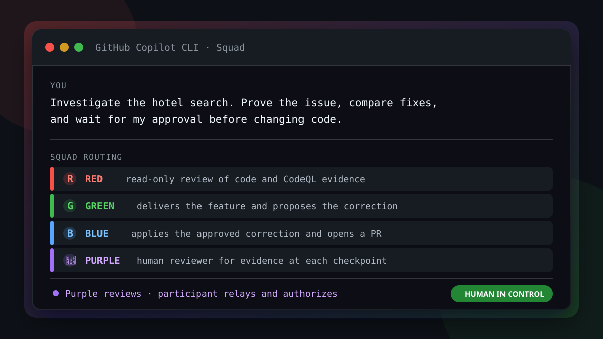
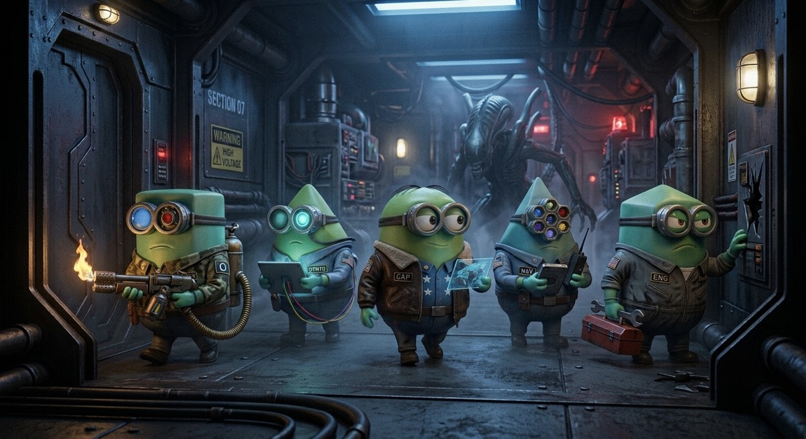

<div align="center">

<h2>GitHub Universe CTF: AI Teams, One Codebase</h2>

<p><strong>Green delivers city search, Red reviews the exposure, Purple validates each checkpoint, and you approve Blue's correction through a PR to main.</strong></p>

<p>
  <a href="https://githubuniverse.com/"></a>
  <a href=".github/steps/1-step.md"></a>
  <a href="https://github.com/features/codespaces"></a>
</p>

</div>

## Workshop overview

This hands-on security exercise is for developers, security practitioners, and
technical leads. You will work with specialist AI agents while retaining
control of reviews, approvals, and delivery.

You will review a CodeQL finding, approve a parameter-binding correction, and
compare local checks with hosted scan evidence. The app uses real public hotel
names with synthetic prices, dates, room options, and challenge records.
Keep it local or use private Codespaces forwarding.

Before starting, open your participant Codespace. The facilitator prepares
Node.js 22, dependencies, GitHub Copilot CLI, `gh`, Squad, and CodeQL.

Complete 15 numbered tasks in order:

1. [Step 1 (Tasks 01 to 05): Discover Squad, recruit your team, and deliver search (Phase `red`)](.github/steps/1-step.md).
1. [Step 2 (Tasks 06 to 08): Explain the exposure and review the CodeQL finding (Phase `purple`)](.github/steps/2-step.md).
1. [Step 3 (Tasks 09 to 10): Ask Green for a correction and approve the scope (`parameter-binding`)](.github/steps/3-step.md).
1. [Step 4 (Tasks 11 to 15): Verify locally (Phase `green`), merge the PR to `main` (Phase `blue`), and confirm CodeQL fixed (Phase `codeql`)](.github/steps/4-step.md).

Use the supplied training prototype. First record normal search behavior, then
investigate the challenge and restore public-only search with parameter binding.


*Baseline: two public stays for Paris.*

## Meet Squad

**Squad** coordinates three specialists and one human reviewer through GitHub
Copilot CLI. Recruit **Green**, **Red**, and **Blue**, then include **Purple** as
the human checkpoint reviewer in the same roster. Copilot CLI runs the
conversation; the Copilot coding agent is not a team member.

> [!NOTE]
> Red, Green, and Blue are workshop roles defined in this repository.
> This is not an official Squad product demonstration.

<p align="center">
  
</p>

<p align="center">
  <sub>Squad routes work to three specialists and Purple, the human checkpoint
  reviewer. The participant relays Purple's decisions and authorizes delivery.</sub>
</p>

| Member | Order of Action | Responsibility | Scoreboard Milestones |
| --- | --- | --- | --- |
| 🟢 **Green** | Step 1 & Step 3 | Delivers the initial feature to `feature/city-search`, then proposes the minimal parameter-binding patch | Publishes `red` (after Purple approval) and prepares scope for `green` |
| 🔴 **Red** | Step 2 & Step 4C | Reviews code and CodeQL findings without editing or exploiting | Supports `purple` (baseline review) and `codeql` (fixed scan) |
| 🟣 **Purple** | All Checkpoints | Human reviewer who validates evidence at each checkpoint; never edits code or runs commands | Validates every checkpoint before you authorize a phase |
| 🔵 **Blue** | Step 4A & Step 4B | Applies Green's approved patch on `fix/city-search`, verifies locally, and merges a PR to `main` after approval | Publishes `green` (local fix verified) and `blue` (PR merged to `main`) |

Learn more about the upstream project in the
[Squad documentation](https://bradygaster.github.io/squad/).

Each step provides commands, prompts, and expected results. Troubleshooting
prompts are optional. Report a queued CodeQL scan as **pending**, not clean.

### Start the exercise

1. Open the Codespace for your participant repository.
1. Follow [Step 1](.github/steps/1-step.md) to initialize Squad, recruit your team, and launch the app in **🖥️ Terminal 1**.
1. Drive the rest of the exercise from **🤖 Terminal 2 (Squad)** and **🌐 Browser**.

<p align="left">
  <a href=".github/steps/1-step.md"></a>
</p>

<details>
<summary>CodeQL access in Codespaces (configure <code>GH_TOKEN</code> if Code Scanning returns 403/404)</summary>

The Codespaces-provided `GITHUB_TOKEN` may not have permission to read Code
Scanning. To enable the final CodeQL review automatically:

1. Create a fine-grained personal access token with access to the participant repository and the repository permission **Code scanning alerts: read**.
1. Add it to your GitHub account under **Settings > Codespaces > Secrets** with the name `GH_TOKEN`, and grant it to the participant repository.
1. Restart an existing Codespace (or create a new one) to load the secret. GitHub CLI gives `GH_TOKEN` precedence over `GITHUB_TOKEN`; never commit the token or paste it in chat.

Confirm that the API is accessible from the Codespace:

```bash
gh api "repos/$(gh repo view --json nameWithOwner --jq .nameWithOwner)/code-scanning/analyses" \
  -f ref=refs/heads/main -f tool_name=CodeQL -f per_page=1 --jq 'length'
```

A number, including `0`, confirms API access only; it does not prove the scan is
clean. A `403` or `404` means the token, repository access, or Code Scanning
availability still needs attention.

</details>



*A humorous interlude, not a literal workshop roster. Explore [Brady Gaster's Squad project on GitHub](https://github.com/bradygaster/squad).*
